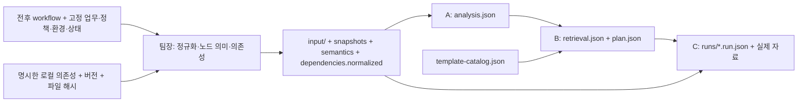

# 입력·모듈 계약 0.4.0

2026-10-11 · [작업 #15](https://github.com/serendipity-sec/platform/issues/15)

## 1. 파일이 흐르는 순서



`policy.json`은 평가할 규칙과 근거를 담고, `task.json`은 정상 업무·입력·성공 조건을 담는다.
정책 문장을 자동으로 실행 가능한 검사로 바꾸는 기능은 아직 없다. 템플릿과 obligation 연결을 사용한다.

## 2. 고정하는 것과 변경하는 것

한 case에서는 업무·정책·환경·초기 상태를 같은 파일로 참조한다. before/after workflow와 명시한
의존성 버전만 달라질 수 있다. `changed_axes`는 `workflow`, `dependencies` 중 비교 축을 기록한다.
새 업무나 정책을 적용하려면 새 case를 만든다. 모든 사용자가 하나의 업무를 써야 한다는 뜻은 아니다.

| 묶음 | 정상 업무 | 달라지는 부분 | 목적 |
|---|---|---|---|
| order-lookup | ORD-1001의 공개 주문 상태 조회 | 응답에 display_status 추가 | HTTP 입력·외부 서비스·응답 |
| support-triage | 문의 3개를 우선순위로 분류 | 응답에 display_queue 추가 | 여러 item·분기·Merge·고정 하위 workflow |

두 번째 사례는 Manual Trigger 뒤 Set에 정상 입력 배열을 담는다. 카탈로그의
`materialized_input_bindings`가 그 parameter 위치를 지정하고 실제 값이 task의 입력과 같은지 확인한다.
실제 웹훅 업무와 같은 배포 형태를 주장하지 않는다.

## 3. 입력·구조 정규화의 완료 범위

| 영역 | 구현된 내용 | 아직 다루지 않는 내용 |
|---|---|---|
| 입력 | 명시된 파일만 읽기, 버전·해시·크기·참조 검사, 원본 보존 | 임의 URL·폴더 자동 수집 |
| 구조 | ID·이름·설정·포트 유형/번호·연결·원본 JSON Pointer 보존 | 의미 관계·변경 영향 알고리즘(A) |
| 의미 | 고정 n8n 버전에서 10종의 제한된 설정, 읽기·쓰기·외부 효과 | 모든 노드·모든 표현식 |
| item | 개수 특성, 분기 포트, 원본 item 연결, FIRST/LINKED 참조 | 모든 반복·binary·복잡한 변환 |
| 오류 | stopWorkflow, Set/HTTP의 명시적 오류 출력 계약 | 자동 재시도·항상 출력·executeOnce |
| 의존성 | 선언된 로컬 workflow/descriptor/runtime 파일, 버전·requires·해시 | MCP/Skill 실행, 실제 권한 증명, 원격/동적 참조 추적 |
| snapshot | raw·구조·선언 설정 해시, 전후 식별자 | 행동 동등성 증명 |

`schemas/support-matrix.json`이 정확한 지원 조합을 나타낸다. `SUPPORTED`는 정적 지원 여부이며
실제 실행했다는 뜻이 아니다. 미지원 하위 workflow가 있으면 상위 handoff도 PARTIAL로 표시한다.

## 4. 노드 의미 표현

`NodeSemantics`에는 읽기/쓰기/effects뿐 아니라 다음을 포함한다.

- `expressions`: 실행하지 않고 파싱한 작은 AST. 현재 item, 다른 노드의 linked item/first item,
  상수·객체·문자열 결합·엄격 비교를 표현한다.
- `assignments`: Set의 출력 필드·자료형·표현식·원본 위치.
- `branches`: If의 true/false 포트와 조건. A는 그래프의 해당 control edge에 조건을 연결한다.
- `item_behavior`: 입력/출력 포트 수와 개수 변화, lineage, 표현식이 어느 item을 보는지.
- `error_behavior`: 중단 또는 오류를 보낼 포트. 미실행·미지원·실패를 성공으로 바꾸지 않는다.
- `resolved_defaults`: 생략된 n8n 기본 설정의 해석. 원본 JSON을 고쳐 쓰지 않는다.
- `unsupported_locations`: 설명하지 못한 설정의 원본 위치.

If 2.3은 조건 하나와 strict type validation만, Merge 3.2는 입력 두 개의 append만 지원한다.
Split Out은 명시한 객체 배열 필드, Execute Workflow는 manifest의 고정 ID·전체 item·동기 대기만 지원한다.
HTTP는 선언된 GET/JSON endpoint만 지원한다. credentials는 선언된 참조이며 실제 권한 증거가 아니다.

## 5. 의존성과 해시

`dependencies.json`에 파일·종류·버전·runtime workflow ID·requires·전후 root를 적는다.
순환·누락·도달하지 않는 선언·한쪽에 같은 runtime ID를 가진 두 정의는 오류다.
전후에서 같은 runtime ID의 다른 버전을 각각 참조하는 것은 허용한다.

동적 하위 workflow나 빠진 고정 ID는 `UNRESOLVED`와 이유를 남기고 `semantic_sha256=null`로 둔다.
`DECLARED_RESOLVED`는 제공된 파일의 연결을 읽었다는 의미다. 숨은 네트워크 의존성까지 찾았다는 뜻은 아니다.

- raw: 파일 원문 bytes. 공백도 바뀌면 달라진다.
- structural: 정규화 구조. 표시 좌표·이름·배열 순서를 보존한다.
- semantic: `DECLARED_CONFIGURATION/config-v1`. node.position만 제외하고 설정·업무·정책·환경·상태·선언 의존성을 포함한다.
- snapshot ID: 실제 비교의 입력을 특정한다. 실행 UUID나 출력 폴더에 의해 바뀌지 않는다.

같은 설정 해시라도 외부 서비스 상태나 비결정적 동작까지 같다고 주장할 수 없다.

## 6. 파일 사이의 공통 약속

| 파일 | 생산자 | 소비자가 확인할 핵심 |
|---|---|---|
| input/manifest.json | 팀장 입력 모듈 | 모든 파일의 해시·크기·schema |
| before/after.normalized.json | 팀장 입력 모듈 | 노드 ID·연결 포트·opaque_fields·source |
| semantics.json | 팀장 의미 어댑터 | 지원 범위·표현식·분기·item·오류·효과 |
| dependencies.normalized.json | 팀장 입력 모듈 | 고정 하위 workflow의 구조와 전후 의미 |
| analysis.json | A | case/snapshot, 원본 위치, typed graph, 변경·영향 경로 |
| retrieval.json | B | analysis ID, KB 파일 해시, 방법·모델 버전, rank·선택 이유 |
| template-catalog.json | 팀장 제공본; C가 구현과 맞춰 확장 | ID/버전, 입력 schema, 실행 방식, 필수 자료 |
| plan.json | B | 고정 정상 입력, template, 초기 상태, 모든 obligation의 연결/미연결 |
| runs/*.run.json | C | side·attempt·run ID, 실제 엔진, 자료·수집·정리 상태 |

실제 산출물 묶음의 `manifest.json`에는 `analysis.json`, `plan.json`, 카탈로그, `input/` 파일,
선택한 retrieval/KB와 `runs/*.run.json`을 포함한다. **모든 ArtifactRef.path는 이 묶음 루트 기준**이다.
예: `runs/before-1/response.json`. baseline의 side별 `run.json`은 그 side 폴더 기준이므로
C가 공통 묶음으로 만들 때 prefix와 해시 참조를 맞춰야 한다.

`check-pipeline`은 schema·해시·ID·포트·조건·정상 입력·obligation·실행 시도 연결을 확인한다.
예시는 `CONTRACT_EXAMPLE`, 실제 A/B는 `MODULE_OUTPUT`, 실제 실행은 `RUNTIME_OBSERVATION`이다.
작성 주체를 바꾸는 것만으로 알고리즘의 정확성이 증명되는 것은 아니다. 구현 테스트가 별도로 필요하다.
실행 파일을 주지 않은 경우 `runtime_record_coverage=NOT_SUPPLIED`다.

## 7. 0.3.0에서 이전

0.4.0 로더는 0.3.0 묶음을 묵시적으로 받아들이지 않는다.

```powershell
uv run --frozen --extra baseline flowdelta migrate-case <old-source-bundle> --out var/converted-04
uv run --frozen --extra baseline flowdelta snapshot var/converted-04 --out var/converted-handoff
```

metadata만 새 폴더로 변환하며 workflow bytes와 옛 묶음은 보존한다. 빠진 의존성을 자동 추측하지 않는다.
별도로 dependencies를 명시해야 선언 설정 해시를 완성할 수 있다. 옛 분석/계획/실행 파일은 변환 대상이
아니다. 새 snapshot에서 다시 생성한다. 옛 Schema와 실행 증거는 이력으로 보존한다.

## 8. 이후 계약 변경 절차

1. 실제 입력에서 현재 표현으로 담지 못하는 내용을 issue에 적고 최소 정상 예제를 붙인다.
2. 팀장이 필드 의미·생산자·소비자·미지원 처리·이전 방법을 정한다.
3. 계약 코드, JSON Schema, 두 reference bundle, 영향을 받는 소비자의 코드를 함께 갱신한다.
4. `tools/refresh_contract_artifacts.py`로 팀 소유 예시를 재생성한다.
5. 손상된 참조·포트·조건·미지원 입력의 명시적 거부와 실제 정상 실행을 확인한다.
6. 영향을 받는 팀원 한 명 이상이 소비자 관점에서 리뷰한다. 승인 후 정해진 순서로 병합한다.

호환성을 깨는 필드 의미·필수 여부 변경은 schema 버전을 올린다. 새 필드를 무조건 무시하는 방식으로
호환성을 가장하지 않는다. 미래의 모든 n8n 기능을 미리 표현했다는 보장은 하지 않는다.
