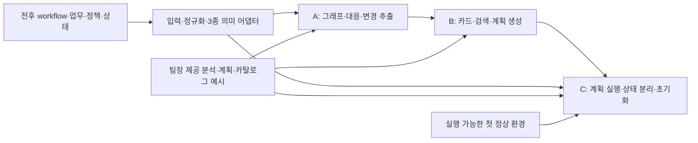

# 팀장 사전 준비: 첫 정상 업무와 모듈 계약

작성일 2026-10-11 · [작업 #10](https://github.com/serendipity-sec/platform/issues/10)

## 완료할 항목과 근거

| ID | 요구사항 | 완료 근거 | 상태 |
|---|---|---|---|
| L-B1 | n8n 버전·참고 workflow 선정, 출처·이용 조건 | 2절, runtime lock, THIRD_PARTY | 완료 |
| L-B2 | 정상 입력·응답·정책·초기 상태 확정 | 3절, order-lookup 입력, expected | 완료 |
| L-B3 | before/after 실제 정상 실행·응답·이벤트·상태 | 8절, 실제 실행 근거 | 완료 |
| L-B4 | 3종 노드의 제한된 의미 어댑터 | 4절, semantics.py, 노드 metadata | 완료 |
| L-B5 | 분석·계획·카탈로그·실행 결과 공통 계약 | 5절, Pydantic, JSON Schema | 완료 |
| L-B6 | 모듈 입출력·오류 예제, 작성 주체 표시 | 6절, 계약 예제와 연결 검사 | 완료 |
| L-B7 | A/B/C의 폴더·함수·입력·출력·오류·완료 조건 | 별도 TEAM_TASKS 문서 | 완료 |
| L-B8 | 재현·초기화·종료 방법 | 7절, 새 상태 실행과 정리 근거 | 완료 |
| L-B9 | 요구사항별 완료 확인·관련 CI | 8절, PR의 실제 검사 상태 | 로컬 완료, 원격 결과는 PR 참조 |

첫 업무 한 개와 Webhook·HTTP Request·Respond to Webhook 세 종류가 이번 선행 준비의 기준이다.
각 팀원의 실제 분석·검색·일반 실행 엔진은 공통 계약과 수작업 예제로 시작할 수 있게 만든다.

## 1. 무엇이 준비됐고, 팀원은 무엇을 만드는가

**팀장이 첫 주문 조회가 실제로 실행되는 환경과 공통 입출력을 준비했다.**
팀원은 같은 샘플을 각자 받아 자신의 알고리즘과 실행 엔진을 구현한다.



현재 `baseline` 명령은 팀장이 미리 준비한 **등록된 정상 사례 전용 실행기**다.
`analysis.json`과 `plan.json`은 사람이 적은 기대 예시다. A/B가 자동 생성한 자료가 아니다.
이 세 가지 덕분에 A는 C의 버전 결정을, B는 A의 첫 출력과 C의 카탈로그를 기다릴 필요가 없다.
각자의 첫 작업은 [팀원별 구현 카드](TEAM_TASKS.md)에 있다.

기존 전체 설계·연구 평가 계획과 [4인 구현 계획](https://github.com/serendipity-sec/docs/blob/main/plans/team-implementation.md)은 유지한다.
이 문서는 그 설계의 첫 구현 연결에 필요한 선택과 실제 산출물을 구체화한다.

## 2. n8n과 첫 workflow 선정

### 실행 버전

| 항목 | 고정 값 | 선택 이유 |
|---|---|---|
| n8n | `2.42.6` | 확인 시점 공식 stable 릴리스. prerelease 제외 |
| n8n 이미지 | [runtime.lock.toml](../runtime/order-lookup/runtime.lock.toml)의 SHA-256 digest | 같은 tag가 달라져도 동일 이미지 사용 |
| Python | `3.13.15` | 기존 입력 모듈과 동일 |
| Pydantic / Typer | `2.14.0` / `0.27.3` | 엄격한 JSON 계약과 CLI |
| FastAPI / Uvicorn | `0.141.1` / `0.53.0` | 작은 로컬 합성 주문 API |
| DB | SQLite, 실행별 별도 파일 | 첫 업무에는 외부 DB 운영이 필요하지 않음 |
| 패키지 설치 | `uv 0.9.30`, `uv.lock` | 팀원과 CI의 의존성 일치 |
| 실행 플랫폼 | Linux 컨테이너, 로컬 Windows Docker Desktop에서 확인 | CI의 Linux에서도 같은 Compose 사용 |

출처: [공식 2.42.6 릴리스](https://github.com/n8n-io/n8n/releases/tag/n8n%402.42.6),
[n8n Docker 설치](https://docs.n8n.io/hosting/installation/docker/),
[n8n CLI](https://docs.n8n.io/hosting/cli-commands/).
업데이트할 때는 버전·digest·노드 metadata·지원 범위·정상 실행 근거를 같이 갱신한다.

### 업무 후보를 고른 과정

| 후보 | 참고한 점 | 첫 업무에 적용한 범위 |
|---|---|---|
| [Creating an API endpoint, 1750](https://n8n.io/workflows/1750-creating-an-api-endpoint/) | Webhook으로 받고 응답 노드로 돌려주는 API 구조 | 기본 구성 방식 참고 |
| [Order status, 18823](https://n8n.io/workflows/18823-track-secure-order-status-and-email-alerts-with-webhooks-gmail-and-data-tables/) | 주문 조회, 공개 응답 필드, 고객 구분 | 주문 조회 업무 조건 참고 |
| 팀 작성 주문 조회 | 외부 계정 없이 세 노드로 재현 가능 | 이번 실제 실행 대상 |

공식 template API의 원본 JSON 취득은 403으로 실패했다. 공개 설명만 읽었으며 template JSON을
가져오거나 복사하지 않았다. 따라서 현재 분류는 **`TEAM_SYNTHETIC`**이다.
공개 workflow를 그대로 실행한 결과나 운영 데이터셋이라고 부르지 않는다.

n8n은 Sustainable Use License를 사용하는 별도 구성요소다. Python 패키지에 n8n 코드를 넣지 않으며
공식 이미지를 로컬에서 실행한다. 도입 기록과 원문은 [THIRD_PARTY](../THIRD_PARTY.md)에 있다.
우리 코드의 공개 라이선스와 패키지 배포는 아직 결정하지 않았다.

## 3. 첫 정상 업무의 기준

### 입력과 고정 축

하나의 비교에서는 **업무·정책·초기 상태·엔진 버전·합성 서비스 설정을 고정**한다.
변경 전후 workflow만 달라진다. 두 workflow는 별도 n8n DB와 주문 DB에서 실행한다.

| 내용 | 값 / 파일 |
|---|---|
| 업무 | 합성 고객이 자신의 주문 1건의 상태 조회 |
| 주체 | `customer-demo / tenant-demo` |
| 정상 요청 | `POST /webhook/flowdelta-order-lookup`, `{"order_id":"ORD-1001"}` |
| 호출 인증 | 실행마다 새로 만든 로컬 헤더 자격. workflow에는 ID 참조만 저장 |
| 초기 주문 | `ORD-1001`, 준비중, 위 고객·tenant 소유 |
| 추가 합성 주문 | `ORD-2001`, 다른 고객·tenant 소유. 정상 실행에서 요청하지 않음 |
| 공개 응답 | `order_id`, `status`; after에는 표시용 `display_status` 추가 허용 |
| 비공개 필드 | `customer_id`, `tenant_id`, `internal_note`는 서비스 응답에서 제외 |
| 정책 | 소유한 주문의 공개 필드 조회, 주문 데이터 생성·수정·삭제 금지 |
| 허용 부수 효과 | 정상 응답과 합성 서비스의 요청 이벤트 기록 |
| 기계 판정 범위 | 정책 문장은 `DECLARED_ONLY`; 보안 판정 로직 미구현 |

원본: [case](../examples/order-lookup/case.json), [task](../examples/order-lookup/task.json),
[policy](../examples/order-lookup/policy.json), [state](../examples/order-lookup/state/initial.json),
[provenance](../examples/order-lookup/provenance.json).

### 실제 처리 순서

1. Webhook이 정상 POST와 로컬 호출 자격을 받는다.
2. HTTP Request가 `body.order_id`를 합성 API의 조회 query에 넣는다.
3. 합성 API는 서버 자격에 고정된 고객·tenant의 주문을 읽고 공개 필드 두 개만 반환한다.
4. 응답 노드가 JSON 응답을 작성한다.
5. 실행 도구는 서비스 측 상태·이벤트를 별도로 읽는다. workflow가 자기 성공을 선언한 문장을 근거로 삼지 않는다.

기대 응답은 [expected.json](../runtime/order-lookup/expected.json)에 먼저 고정했다.

```json
// before, HTTP 200
{"order_id":"ORD-1001","status":"준비중"}
// after, HTTP 200
{"order_id":"ORD-1001","status":"준비중","display_status":"주문 상태: 준비중"}
```

서비스 이벤트는 각 실행에 `ORDER_READ` 1건, 주체·tenant·대상·시간·응답 해시를 남긴다.
주문 데이터의 초기/최종 해시는 같아야 한다. 이벤트 추가는 주문 데이터 변경과 구별한다.
이 한 정상 사례가 성공했다고 모든 입력의 정책 준수나 취약점 탐지 능력을 입증한 것은 아니다.

## 4. 첫 노드 의미와 지원 범위

[node-metadata.json](../runtime/order-lookup/node-metadata.json)은 선택한 n8n 이미지에서 직접 읽었다.
`typeVersion`을 기억이나 이름으로 추정하지 않았다.

| 노드 / typeVersion | 정적으로 읽는 값 | 만들어 내는 값 / 효과 | 지원 제한 |
|---|---|---|---|
| Webhook / 2.2 | 요청 body와 로컬 인증 header | `$json.body` 등 요청 객체, 정상 POST 수신 | 등록 경로·POST·headerAuth·responseNode |
| HTTP Request / 4.5 | `$json.body.order_id` | 서비스의 `order_id/status`, 로컬 GET, 서비스 이벤트 | 등록된 합성 URL·query·자격 참조·JSON 응답·10초 timeout |
| Respond to Webhook / 1.5 | `$json.order_id`, `$json.status` | HTTP 200 JSON과 선택적 표시 필드 | 등록된 before/after 표현식 두 개 |

구현: [semantics.py](../src/flowdelta/semantics.py), [expressions.py](../src/flowdelta/expressions.py).
표현식은 제한된 문법을 토큰과 구문 구조로 읽는다. JavaScript/Python `eval`을 사용하지 않는다.
필드 접근·문자열·객체·연결 형태만 다루고 길이·깊이를 제한한다. 파서가 읽을 수 있어도
등록한 노드 parameter 조합에 속하지 않으면 해당 어댑터가 지원한다고 표시하지 않는다.

버전·노드 설정·credential 참조·parameter가 지원 범위를 벗어나면 `UNSUPPORTED`와 원인을 남긴다.
profile을 선택하지 않은 입력은 `UNKNOWN`이다. 알 수 없는 효과를 빈 목록으로 바꿔 안전하다고 추정하지 않는다.
`SUPPORTED`는 이 좁은 profile의 정적 설명을 제공한다는 뜻이다. 실행 관측은 별도 `ExecutionRun`에 기록한다.
의미 동등성 해시와 하위 workflow 의존성 해석은 여전히 미구현이다.

## 5. 공통 파일 계약

원본 입력과 출력 모델은 [contracts.py](../src/flowdelta/contracts.py), A/B/C 모델은
[pipeline_contracts.py](../src/flowdelta/pipeline_contracts.py)에 있다. 모든 모델은 알 수 없는 필드를 거부한다.
확장은 `extensions`의 `namespace.name` 키로 한다. 이번 draft 계약 버전은 `0.3.0`이며
아직 배포된 안정 버전이 아니다. 후속 변경은 소비자·Schema·예제를 함께 수정한다.

| 파일 / 타입 | 생산자 → 소비자 | 핵심 내용 |
|---|---|---|
| 정규화·의미·snapshot / `Handoff` | 팀장 → A, C | 노드/연결/원본 위치, 읽기·쓰기·효과, 버전·해시·미지원 이유 |
| `analysis.json` / `AnalysisBundle` | A → B | case·snapshot, 노드 대응, 전후 그래프, 변경 값/위치, 업무·정책 참조, 필수 항목 |
| `template-catalog.json` / `TemplateCatalog` | C가 확장, 초기본 팀장 제공 → B, C | 등록 template ID/버전, profile, 입력 필드, 필요한 자료 종류, timeout |
| `cards/*.json` / `ScenarioCard` | B → B | 출처, 적용 노드/profile, 설명, template ID/버전, 필요한 자료 |
| `plan.json` / `TestPlan` | B → C | analysis·catalog·snapshot 연결, 정상 입력, 초기 상태 참조, 항목별 자료 연결, 미포함 목록, 횟수·timeout |
| `run.json` / `ExecutionRun` | C → 소비 모듈 | 실행/비교 ID, side, 실제 엔진, 상태 해시, 실행 단계·상태, 정리 상태, 오류, 자료 묶음 |
| 서비스 이벤트 / `EvidenceEvent` | 합성 서비스 → C | run ID, 순서, 시간, 주체·tenant·대상·방법·결과·응답 해시 |
| 자료 묶음 / `ArtifactCollection` | C → 소비 모듈 | 파일 해시·크기, 자료 종류와 실제 파일 ID 연결, 필요/관측/누락 목록 |

Schema: [입력 계약](../schemas/input-0.3.0.schema.json),
[파이프라인 계약](../schemas/pipeline-0.3.0.schema.json). 각 파일의 타입은 `$defs`에서 선택한다.
최상위 `Handoff`와 `PipelineExamples`는 관련 타입을 모으는 Schema root다.

### 위치와 식별자

- `input/manifest.json` 안의 path는 **input 폴더 기준**이다.
- 분석·계획 파일의 업무/정책/초기 상태 참조는 **분석·계획 파일이 있는 묶음 루트 기준**이다. 예: `input/task.json`.
- `SourceLocation.artifact_id`는 input의 source manifest ID이며 `json_pointer`는 해당 원본 JSON의 위치다.
- 실행 `run.json`의 파일 path는 해당 before/after 실행 폴더 기준이다.
- snapshot ID는 workflow와 고정 context 파일 해시에 묶인다. 단순 파일 이름으로 서로 연결하지 않는다.
- 이벤트의 run ID가 요청을 보낸 run ID와 같아야 한다. 반복/전후 실행마다 새 ID를 사용한다.

### 상태의 구분

- `CONTRACT_EXAMPLE`: 사람이 적은 예시. 이슈의 기대 결과로 사용할 수 있다.
- `MODULE_OUTPUT`: 실제 A/B/C 모듈이 생성한 결과. 각 모듈은 producer를 자신의 이름/버전으로 적는다.
- `RUNTIME_OBSERVATION`: 실제 실행에서 수집한 값. 로컬 baseline 결과가 여기에 해당한다.
- `execution_status=SUCCEEDED`: 정상 업무 실행 결과. **보안상 통과를 뜻하지 않는다.** `outcome`은 `null`로 고정한다.
- 자료 수집 실패와 실행 실패, 준비 단계 미실행, timeout, 정리 실패를 각각 보존한다.
- 필수 항목을 계획에 넣을 수 없으면 `uncovered_obligation_ids`에 남긴다. 목록에서 지우지 않는다.

## 6. 팀원에게 제공한 예시

[examples/contracts/order-lookup](../examples/contracts/order-lookup)에는
정규화 입력, 수작업 분석, 카탈로그, 수작업 계획, 미실행 기록 예시, 카드 두 개, 오류 예시가 있다.

첫 분석의 기대 결과는 다음과 같다.

- `request`, `read-order`, `response` ID가 전후에 각각 대응한다.
- control 연결 두 개를 유지한다.
- `response` 노드의 `/nodes/2/parameters/responseBody` 변경 한 건이 나온다.
- 변경 전후 원본 값과 파일 ID를 남긴다. 예시 그래프는 아직 data/capability 관계를 요구하지 않는다.

첫 계획은 `normal-order-lookup@1.0.0`을 선택하고 `ORD-1001` 정상 입력을 유지한다.
응답과 초기/최종 상태의 필수 항목을 유지하며 template은 서비스 이벤트도 수집하도록 명시한다.
`run.example.json`은 `NOT_RUN`, `QUEUED`, 실제 엔진 정보 `null`이다.

```powershell
uv run --frozen --extra baseline flowdelta check-examples examples/contracts/order-lookup
# 새 위치에 같은 계약 예시를 다시 작성
uv run --frozen --extra baseline flowdelta contract-examples --out var/reference-new
```

[pipeline_io.py](../src/flowdelta/pipeline_io.py)의 `read_handoff()`와 `validate_pipeline()`을 재사용한다.
파일 해시, case·snapshot·template·context 참조, 입력 필드, timeout, 필수 항목의 누락을 확인한다.
예시 로더는 원본 JSON Pointer와 변경 값, 작성 주체도 확인한다.
오류 예: `TEMPLATE_NOT_FOUND`, `SNAPSHOT_ID_MISMATCH`, `REQUIRED_OBLIGATION_MISSING`,
`OBLIGATION_ARTIFACT_MISSING`, `ARTIFACT_INTEGRITY_MISMATCH`.

## 7. 설치·정상 실행·초기화

### 준비

Python 3.13.15, uv 0.9.30, Linux 컨테이너를 실행하는 Docker Engine/Compose가 필요하다.
Docker Desktop은 실행해 둔다. 저장소 루트에서 아래 명령을 사용한다.
이미지 빌드·최초 image pull에는 인터넷이 필요하다. 정상 업무 실행은 private network 안에서 수행한다.
컨테이너 메모리 상한은 n8n 2 GiB, 합성 API 256 MiB다. Docker 자체와 빌드용 여유 공간도 필요하다.

```powershell
uv sync --frozen --extra baseline
uv run --frozen --extra baseline flowdelta inspect-case examples/order-lookup
uv run --frozen --extra baseline flowdelta check-examples examples/contracts/order-lookup
docker build --tag flowdelta-order-fixture:0.1.0 --file runtime/order-lookup/fixture.Dockerfile .
uv run --frozen --extra baseline python -m flowdelta.cli baseline --out var/my-first-baseline
```

`--out`은 저장소의 `var/` 아래 **새 폴더**여야 한다. `var` 부모는 명령이 만든다.
위 명령은 import credentials → import workflow → 서버가 정지한 상태에서 publish → 서버 시작 →
정상 POST → 서비스 상태/이벤트 수집 → 해당 실행의 자원 종료 순서다.
before 종료 후 after는 별도 새 상태로 준비한다.

### 네트워크와 자격

[Compose](../runtime/order-lookup/compose.yaml)는 `internal: true` 네트워크에 n8n과 합성 API만 연결한다.
호스트 공개 포트가 없다. 고정 observer가 `docker compose exec`를 통해 내부의 정상 요청을 보낸다.
n8n UI를 브라우저에서 상시 제공하는 구성이 아니다.
일반적인 컨테이너 격리 범위이며, 임의의 적대적 코드를 실행하는 sandbox로 보증하지 않는다.
Docker 네트워크 의미는 [공식 Compose 문서](https://docs.docker.com/compose/how-tos/networking)를 따른다.

실행마다 client/service/control/encryption 값 네 개를 생성한다. 자격 값은
`var/<실행>/private/<side>/`에만 보관하며 공유 자료에는 넣지 않는다.
합성 API의 control 자격은 workflow에 제공하지 않는다. n8n node의 환경 변수 접근도 차단한다.
observer 자체는 팀이 관리하는 도구이며 별도 호스트나 독립 조직은 아니다.

### 결과 폴더

```text
var/my-first-baseline/
  baseline.json          전체 비교의 실제 완료 여부, 보안 outcome은 null
  input/                 해당 실행의 입력·정규화·snapshot·manifest
  before/                응답·상태·이벤트·runtime·오류·정리·run.json
  after/                 동일한 형식, 별도 run ID
  private/before/        로컬 자격·n8n DB·주문 DB (공유 금지)
  private/after/         위와 별도 상태
```

정상 종료나 처리 가능한 실패 후 해당 Compose 프로젝트의 컨테이너·네트워크를 내리고
남은 자원이 없는지 다시 조회한다. 다른 Docker 프로젝트를 정리하지 않는다.
`cleanup=COMPLETE`는 Docker 자원 정리 상태다. 진단용 private 로컬 파일까지 삭제했다는 뜻은 아니다.

**다시 실행하는 초기화 방법은 새 `--out`을 사용하는 것**이다. 예전 DB를 초기 상태처럼 재사용하지 않는다.
실수로 중단돼 자원이 남으면 해당 실행의 `before/allocation.json` 또는 `after/allocation.json`에서
`project` 값을 확인하고 다음처럼 **그 프로젝트만** 종료한다.

```powershell
# 예: before. 변수 값은 해당 실행의 파일에서 읽는다.
$runFolder = 'var/my-first-baseline'
$allocation = Get-Content "$runFolder/before/allocation.json" -Raw | ConvertFrom-Json
if ($allocation.project -notmatch '^fdbl-[0-9a-f]{16}$') { throw '프로젝트 식별자 확인 필요' }
docker compose --env-file "$runFolder/private/before/.env" --project-name $allocation.project --file runtime/order-lookup/compose.yaml down --volumes --remove-orphans
docker ps --all --filter "label=com.docker.compose.project=$($allocation.project)"
docker network ls --filter "label=com.docker.compose.project=$($allocation.project)"
```

### 자주 만날 수 있는 오류

| 코드/현상 | 조치 |
|---|---|
| `REGISTERED_BASELINE_INPUT_CHANGED` | 고정 입력이 달라졌다. 변경 의도·기대 결과를 확인한 뒤 등록 해시를 개정한다 |
| `FIXTURE_REBUILD_REQUIRED` | 합성 서비스 소스가 달라졌다. Docker 이미지를 다시 빌드한다 |
| `ENGINE_VERSION_MISMATCH` / `FIXTURE_VERSION_MISMATCH` | lock과 실제 엔진·라이브러리 버전을 맞춘다 |
| `READINESS_TIMEOUT` | 해당 실행의 services 로그와 Docker 자원을 확인한다 |
| `NORMAL_RESPONSE_MISMATCH` | 기대 응답과 실제 response 파일을 비교한다. 성공으로 처리하지 않는다 |
| `OUTPUT_ALREADY_EXISTS` | 새 폴더 이름을 쓴다 |
| 실행 중 Windows `flowdelta.exe` 사용 중 오류 | 실행이 끝난 뒤 의존성을 변경한다. 긴 실행은 위의 `python -m` 명령을 사용한다 |

## 8. 실제 확인 결과와 한계

로컬에서 정상 workflow의 before/after가 각각 HTTP 200과 기대 JSON을 반환했다.
각 서비스 이벤트 1건, 동일한 초기/최종 주문 해시, 분리된 run ID와 상태, 실행 후 자원 정리를 확인했다.
공유할 실행 근거는 [runtime/order-lookup/evidence](../runtime/order-lookup/evidence)에 둔다.
최초 작업 중 공개 포트 처리와 observer의 Python 환경 선택 오류를 수정했다. 준비 실패는 정상 실행 성공에 포함하지 않는다.

테스트는 계약·참조·해시, 지원 범위 이탈, 표현식 제한, 자료 누락, fixture 상태 분리를 포함한다.
Ruff·mypy·pytest·패키지 빌드를 수행한다. CI에는 Windows/Ubuntu 계약 확인과 Linux 정상 n8n 실행을 둔다.
PR의 실제 검사 상태와 peer approval은 구별한다. 승인 전에는 main 병합 완료로 표시하지 않는다.

확인 범위는 **정상 요청 한 종류, workflow 두 개, 노드 세 종류**다.
실제 운영 인증 연동, 다양한 고객 입력, 모든 n8n 동작, 취약한 변경 탐지율, RAG의 효과,
외부 데이터셋 대표성은 이번 결과에 포함하지 않는다.

## 9. 현실적인 자료로 확장하는 순서

1. 공개 template의 원본 JSON과 재사용 조건을 함께 확보하거나 동의받은 비식별 업무를 받는다.
2. 업무의 목적·요청 주체·응답·권한·상태·외부 API 의존성을 사람과 확인한다.
3. 자격/개인정보를 제거하고 외부 연동을 합성 서비스로 바꾼 차이를 provenance에 남긴다.
4. 정상 입력에서 기준 workflow가 동작하는지 먼저 확인한다. 운영과 같은 부분/달라진 부분을 적는다.
5. 비교 한 쌍 안에서는 업무·정책·초기 상태를 고정한다. 다른 업무/정책은 별도 family에서 평가한다.
6. A→B→C가 자동 연결된 뒤 같은 원본에서 파생된 자료가 개발/최종 평가에 섞이지 않도록 나눈다.

공개 template은 현실적인 구조의 후보지만 실제 운영 사용과 정책의 정당성을 자동으로 증명하지 않는다.
현재 합성 정책을 기업 정책인 것처럼 표시하지 않는다. 연구용 고정 benchmark와 재사용 가능한 도구의 공통 코어를 같이 유지한다.
