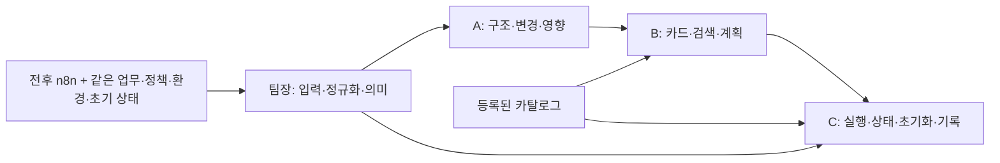

# 팀원 배정 전 준비 현황과 개발 인계

2026-10-11 · 계약 **0.4.0** · [구현 PR #16](https://github.com/serendipity-sec/platform/pull/16)

이 문서는 기존 전체 설계를 유지하면서 **지금 준비한 코드와 팀원이 이어 만들 부분**을 설명한다.
기존 `docs` 저장소의 전체 설계·평가 계획과 로컬 `plans/implementation-design.md`를 덮어쓰지 않았다.
0.3.0의 첫 입력·주문 실행 이력은 LEADER_START/LEADER_BASELINE에 남겼다.

## 1. 지금 어디까지 된 것인가

**팀원이 같은 입력과 계약으로 구현을 시작하는 데 필요한 제한된 기반을 준비했다.**
처음의 단일 주문 예제에서 더 나아가 분기·여러 item·고정 하위 workflow·오류 처리의 표현과 실제 동작을 확인했다.
미래의 모든 n8n 기능과 모든 업무에서 명세 변경이 없을 것이라는 보장은 할 수 없다.

| 구분 | 현재 상태 | 근거 |
|---|---|---|
| 입력·구조 정규화 | 선정 범위 구현 | loader, normalized 구조, 원본 위치·해시·참조 검사 |
| 의미 어댑터 | 10종의 제한된 버전/설정 구현 | support-matrix, core/HTTP 어댑터 |
| 두 업무의 동일 계약 사용 | 준비 | order-lookup, support-triage source/reference bundle |
| 실제 n8n과 추출 의미 비교 | 등록 사례에서 확인 | 10개 실행 사례의 235개 비교 항목 일치 |
| 공개 원본 확보 | 공개 저장소 원본 4개 확보 | MIT LICENSE, 고정 commit, 파일별 해시 |
| 그 원본의 실제 운영 실적 | 독립 확인 안 됨 | 작성자 설명만 확보 |
| A/B/C 실제 생성물 자동 연결 | 아직 안 됨 | A/B/C 구현은 팀원 과제; 소비자 검사와 예시만 준비 |
| 취약 변경 탐지·연구 성능 | 아직 측정 안 함 | 이번 자료는 정상 동작과 계약 적합성 확인용 |

이전에 “첫 정상 실행과 공통 형식 완료”라고 한 범위보다 확장했다.
완성된 연구 시스템이나 모든 데이터에 충분한 계약으로 표현해서는 안 된다.

## 2. 전체 설계를 주문 조회 하나로 이해하기

예를 들어 기존 응답이 `order_id, status`이고 수정 후 `display_status`가 추가된 경우다.

1. **팀장 모듈:** 전후 n8n JSON과 정상 입력 `ORD-1001`, 공개 응답 필드 정책, 초기 주문 DB,
   고정 엔진 설정을 읽는다. 파일 해시·참조를 확인하고 노드·포트·설정을 공통 형식으로 정리한다.
2. **A:** 전후 노드 ID를 대응시키고 응답 설정이 바뀐 원본 위치를 찾는다. 제어·데이터·권한 관계와
   변경의 영향을 `analysis.json`에 담는다. 지금의 손으로 작성한 분석 예시를 자동 생성물로 바꾸는 일이다.
3. **B:** 해당 업무·노드·변경에 맞는 지식 카드를 찾고, 실행 가능한 등록 템플릿을 고른다.
   정상 입력·초기 상태·필요한 자료와 정책 항목을 연결해 `plan.json`을 만든다.
4. **C:** plan을 읽고 전후를 별도 상태에서 실행한다. 실제 응답, 서비스 이벤트, 상태,
   노드 출력과 원본 item 연결, 종료·정리 상태를 파일로 남긴다.



현재 `baseline`과 `conformance`는 팀장 준비용 고정 실행 도구다. C는 이를 바탕으로 plan을 처리하는
일반 실행 엔진을 구현한다. 업무 실행 성공을 곧바로 보안상 통과로 바꾸지 않으며, 실행 결과의 outcome은 null이다.
누가 검증·판정·보고만 전담하는 역할 분배는 하지 않는다. 네 명 모두 구현한다.

## 3. 처음 계획한 L-01~L-05와 대응

| 작업 | 이번에 준비한 구현 | 제한 |
|---|---|---|
| L-01 입력 loader | case/task/policy/environment/state/provenance, manifest, explicit dependency, 엄격한 JSON/버전/해시 오류 | 명시한 로컬 파일만 읽음 |
| L-02 구조 정규화 | 모든 노드·포트 종류/번호·연결·설정·미지 필드·원본 위치 보존, 결정적 출력 | 실제 의미 그래프 생성은 A |
| L-03 의미 어댑터 | 엔진·typeVersion·설정별 registry, reads/writes/effects, AST·분기·item·오류·기본값 | 등록한 부분집합만 해석 |
| L-04 의존성·snapshot | 전후 dependency closure, 고정 하위 workflow, 버전·해시, 누락/순환/동적 참조 표시 | 선언된 MCP/Skill descriptor는 파일 고정만; 실행·권한 해석 안 함 |
| L-05 CLI·두 업무 | inspect/snapshot/migrate, 두 source bundle, 분석·계획·카탈로그 예시, 소비자 검사 | 실제 A/B/C 생성기는 아직 없음 |

따라서 **선정한 두 업무와 지원 조합에서 필요한 입력·정규화 준비는 구현했다.**
초기 로드맵의 모든 노드·MCP·Skill·AI·반복 처리까지 구현했다는 의미는 아니다.

## 4. 무엇을 고정할지에 대한 결정

연구와 재사용 가능한 개발 구조를 함께 유지한다.

- 하나의 비교에서는 업무·정책·환경·초기 상태를 고정한다.
- 수정 전후 workflow와 명시한 의존성 버전을 비교 축으로 둔다.
- 프로그램 전체에 주문 업무를 하드코딩하지 않고 case·adapter·template로 분리한다.
- 다른 업무를 추가할 때 새 bundle과 필요한 adapter/template를 등록한다.
- 일반적인 임의 n8n 실행 기능은 지금의 C 첫 구현 범위에 포함하지 않는다.
- 정책의 문장·근거·적용 규칙은 자료로 보존한다. 정책을 해석하는 자동화 정확성은 별도로 다뤄야 한다.

공개 라이선스와 배포 방식은 팀 결정으로 남아 있다. 입력 형식·설치·재현 방법을 공개 가능한 형태로
정리한 것과 실제 공개 배포 완료는 구분한다. 이번 개발은 모델 API 키 없이 착수할 수 있다.

## 5. 확보한 실제 원본과 합성 자료의 차이

### 공개 원본

출처는 [ibam28/customer-support-ai-automation-n8n](https://github.com/ibam28/customer-support-ai-automation-n8n/tree/71fee7067364e9ac139a55bca3683c15b5ec2c16)이다.
고정 commit은 `71fee7067364e9ac139a55bca3683c15b5ec2c16`이며,
[MIT LICENSE](https://github.com/ibam28/customer-support-ai-automation-n8n/blob/71fee7067364e9ac139a55bca3683c15b5ec2c16/LICENSE)를 먼저 확인하고 고지를 함께 보존했다.

| 원본 파일 | 노드 | 연결 | 확인한 범위 |
|---|---:|---:|---|
| customer-support.json | 31 | 35 | 구조 파싱·정규화 |
| ticket-management.json | 14 | 19 | 구조 파싱·정규화 |
| error-handler.json | 3 | 2 | 구조 파싱·정규화 |
| subflows/customer-lookup.json | 3 | 2 | 구조 파싱·정규화 |
| 합계 | 51 | 58 | 원본을 실행한 결과는 아님 |

원본 JSON·README·아키텍처/보안 설명·정상 요청/응답 예시와 파일별 SHA-256을
[`examples/public-sources/customer-support/`](../examples/public-sources/customer-support/)에 보존했다.
획득 기록은 acquisition.json, 정규화 범위는 structure-summary.json이다.

이 자료에는 Code·Postgres·Switch·동적 하위 workflow 같은 현재 미지원 구조도 있다.
필드를 잃지 않고 구조를 읽었다는 점만 확인했다. 모든 의미나 정책의 타당성을 확인한 것이 아니다.
작성자가 운영 용도를 설명했지만 실제 배포·이용 내역은 독립 확인하지 않았다.
대표 customer-support 파일의 조회된 Git 이력은 최초 추가뿐이어서 **실제 수정 전후 쌍도 아직 없다.**
한 저장소의 네 workflow를 서로 독립적인 네 업무 계열로 세지 않는다.

### 실행한 자료

주문 조회와 문의 분류는 **TEAM_SYNTHETIC**이다. 외부 원본 코드를 실행하거나 그대로 가져온 업무가 아니다.
문의 분류는 공개 고객지원 구조에서 착안하되, 외부 계정·DB·발송을 제외하고 팀이 직접 작성했다.

| 항목 | 주문 조회 | 문의 분류 |
|---|---|---|
| 입력 | order_id 하나 | ticket_id·priority를 가진 객체 3개 |
| 정책 기준 | 공개 주문 필드, 읽기 전용 상태 | priority ≥ 3이면 urgent, 그 외 standard |
| 정책의 근거 | 팀이 정한 합성 서비스 조건 | 팀이 정한 실험 조건 |
| 원본 환경과 차이 | 로컬 합성 API·SQLite·테스트 자격 | Manual Trigger·메모리 JSON, 외부 발송/DB 없음 |
| 사용 목적 | HTTP 전달과 상태 보존 | item·분기·Merge·고정 child 전달 |

실제 조직 정책을 확보했다고 표시하지 않는다. 연구 데이터셋을 확대할 때는 업무 문서·정책 근거·정상
입출력·환경 차이·재사용 허가·변경 이력을 한 묶음으로 확보해야 한다.
동의를 받은 비식별 실제 사례가 생기면 별도 family로 등록하고, 파생 사례는 같은 분할에 둔다.
개발/최종 평가 분리와 독립 정답 검토는 기존 연구 설계를 유지한다.

## 6. 계약이 확장될 때의 문제를 줄인 장치

| 이전에 우려한 문제 | 이번 장치 | 남는 경계 |
|---|---|---|
| 포트 번호나 분기 의미가 사라짐 | 정규화 포트와 BranchCondition, 그래프 포트/조건 대조 | 복수 조건·다른 분기 노드는 추가 지원 필요 |
| 여러 item을 단일 JSON으로 오해 | item 개수·포트·pairedItem, FIRST와 LINKED 분리 | 복잡한 루프·binary 미지원 |
| 오류를 일반 출력으로 착각 | 오류 모드/포트와 실행·수집·정리 상태 분리 | 실제 오류 비교는 Set의 자료형 오류에서 확인 |
| 하위 workflow 바뀌었는데 같은 입력으로 간주 | 명시한 전후 closure와 dependency 해시 | 동적/원격 참조는 미해결로 표시 |
| 노드 버전·기본값 차이를 놓침 | 엔진과 노드 버전 고정, 기본값 명시 | 다른 버전에는 다시 확인 필요 |
| 팀원이 제각각 JSON을 만듦 | Pydantic·JSON Schema·두 reference bundle·check-pipeline | 실제 생산자 연결은 코드가 나온 뒤 확인 |
| 형식 변경 시 과거 자료가 조용히 섞임 | 0.4.0 엄격 거부와 명시적 migrate-case | 옛 analysis/plan/run은 다시 생성 필요 |

자세한 필드, 해시의 의미, 파일 기준 경로와 이전 절차는 [입력 계약 0.4.0](INPUT_CONTRACT_04.md)에 있다.
이 장치는 미지원 입력과 계약 파손을 드러내기 위한 것이다. 모든 미래 확장 문제가 사라졌다는 증명은 아니다.

## 7. 실제 실행에서 확인한 결과

실행 환경은 n8n 2.42.6의 digest 고정 Linux 이미지, Windows Docker Desktop이다.
문의 구조 사례는 network=none, 주문은 외부에 포트를 열지 않은 internal network에서 실행했다.

| 사례 | 관측한 핵심 |
|---|---|
| 문의 before/after | 3 item의 분류·Merge·child 입력/출력·display_queue 변경 |
| all-true | 한쪽 분기만 실행될 때의 흐름; 다른 분기는 미관측으로 유지 |
| empty-batch | 빈 배열 뒤에서 실행되지 않는 노드를 미관측으로 유지 |
| error-stop | 잘못된 숫자 변환으로 예상한 실행 실패·중단 관측 |
| error-regular | 오류를 regular output으로 계속 전달 |
| error-output | 오류를 error output으로 분리 |
| named-references | 다른 노드의 linked item과 first item 구별 |
| 주문 before/after | Webhook body → HTTP query → 독립 서비스 이벤트/응답 → 최종 응답 |

문의 쪽 **8개 등록 사례, 193개 비교 항목**, 주문 전후 **42개 항목**, 합계 **235개 항목이 일치**했다.
전후/파생 실행 10개는 독립적인 업무 10개가 아니다. 업무 계열은 두 개다.
공통 코드의 pytest **102개**와 공유 증거의 무결성·변경 탐지 검사 **2개**, 합계 **104개**가 로컬에서 통과했다.
Ruff, mypy, 패키지 빌드도 통과했다.

실제 자료는 [`runtime/readiness-evidence/summary.json`](../runtime/readiness-evidence/summary.json),
각 사례 JSON, 그 파일의 해시 manifest에 있다. 선택한 관측 파일만 공유하며 SQLite·자격·원본 stdout은 제외했다.
이 아카이브는 실제 A/B/C pipeline bundle이 아니다.
현재 커밋의 원격 CI 상태는 PR checks에서 확인한다. 문서의 로컬 통과를 원격 통과로 대신하지 않는다.

### 실행 중 발견하고 반영한 차이

1. n8n CLI의 publish 직후에는 고정 하위 workflow의 실행용 publication이 완성되지 않았다.
   고정 버전에서 로컬 서버를 시작해 준비 완료를 기다린 뒤 종료하고 실행하자 child 호출이 연결됐다.
   처음 두 probe의 실패를 성공으로 덮어쓰지 않고 로컬에 보존했다.
2. n8n이 생략된 노드 기본 설정을 실행 데이터에 채웠다. `duplicateItem=false`,
   `sendBody=false`, `neverError=false` 등을 명시적으로 다뤄 원본 설정과 대조했다.
   주문 첫 비교는 이 차이를 발견해 실패했고, 보완 후 새 전후 실행이 일치했다.
3. 새 CI 호스트에는 이미지 캐시가 없었다. 고정 digest 이미지를 먼저 준비하도록 수정했다.
4. Linux CI에서는 Docker의 자동 삭제와 명시적 정리가 겹쳤다. 일회성 컨테이너 이름을 재사용하지 않고,
   삭제 명령 하나의 반환값 대신 해당 실행 label의 최종 잔여 목록으로 정리를 확인하도록 수정했다.

이 관측은 선택한 버전과 사례에 관한 것이다. 다른 n8n 버전에도 같은 절차가 필요하다고 일반화하지 않는다.

## 8. 팀원에게 바로 줄 작업

세부 함수·수정 폴더·입출력·오류·완료 조건은 [TEAM_TASKS](TEAM_TASKS.md)에 있다.

| 담당 | 첫 구현 | 첫 제출물 | 그다음 구현 |
|---|---|---|---|
| 팀장 | 준비된 입력 코어 관리 | 이 문서·공통 코드·두 bundle | 요청된 추가 어댑터와 계약 변경 |
| A · #12 | 제공된 input에서 control graph·동일 ID 대응·변경 추출 | 자동 생성 analysis.json | 두 번째 업무의 분기/child, 의미 관계·영향 경로 |
| B · #13 | 카드 로더·결정적 검색·등록 template 선택 | retrieval 기록과 자동 plan.json | 두 업무 공통 계획, 검색 방법 비교/RAG |
| C · #14 | plan을 읽는 실행 수명주기·상태 분리·초기화 | before/after run과 실제 자료 | 문의 template, 중단/재실행·동시성 |

A는 B/C를 기다리지 않는다. B는 손으로 작성한 분석 예시로 시작하고, C는 계획 예시와 동작하는 환경으로 시작한다.
다른 팀원의 실제 파일이 나오면 그 입력만 차례로 교체한다.

### 각자 착수 전 공통 확인

```powershell
uv sync --frozen --extra baseline
uv run --frozen --extra baseline flowdelta check-examples examples/contracts/order-lookup
uv run --frozen --extra baseline flowdelta check-examples examples/contracts/support-triage
```

A/B는 여기까지 Docker 없이 시작한다. C는 README의 build/baseline/conformance 명령으로 실행 환경을 확인한다.
공통 계약을 고칠 필요가 있으면 각자가 임의의 필드를 추가하지 말고 issue에 사용 예를 붙여 팀장과 연결한다.

## 9. 합치는 순서와 남은 완료 조건

1. A의 analysis를 기준 예시와 교체한다. 원본 위치·포트·분기·snapshot 연결을 확인한다.
2. B의 plan과 retrieval을 교체한다. 검색 근거와 모든 obligation의 연결/미연결이 보존되는지 확인한다.
3. C의 실행 결과를 붙인다. root 기준 ArtifactRef, before/after·attempt별 ID와 실제 파일 해시를 확인한다.
4. `check-pipeline`을 통과시키고 두 업무가 팀원 구현을 통해 실제 실행되는지 확인한다.
5. 그다음 데이터 계열과 지원 범위를 늘리고 연구 비교군을 연결한다.

공통 계약 검사 통과, 실제 정상 업무 실행, 연구상 탐지 성능은 서로 다른 완료 조건이다.
지금은 **1~4를 팀원 코드로 수행할 준비까지 끝난 상태**다. 실제 연결 완료는 아직 표시하지 않는다.

## 10. 팀장이 직접 정해야 하는 것

준비 코드와 자료는 제공됐다. 다음은 사람과 일정에 관한 결정이다.

1. #12/#13/#14에 A/B/C의 실명을 연결한다.
2. 각자의 가용 시간을 확인하고 첫 PR 제출일을 합의한다.
3. 시작 커밋을 한 번 고정해서 전달한다. 현재 검토용 기준은 PR #16 위의 인계 문서 PR이다.
4. 본인 외 팀원에게 공통 계약과 해당 소비 입력을 리뷰하도록 맡긴다.
5. 첫 모듈 연결 회의에서 두 업무의 case → analysis → plan → run 파일을 함께 연다.

실명·개별 일정은 추측해서 채우지 않았다. `CONTRIBUTING.md`는 팀원 1명 이상의 승인을 요구하므로
자동 검사 통과만으로 본인 PR을 병합하지 않는다. 공개 원본의 실제 운영 증거는 소유자의 확인/동의가 필요한 별도 과제다.

## 참고한 공식 의미 설명

- [n8n data structure](https://docs.n8n.io/build/work-with-data/understand-n8ns-data-structure.md)
- [n8n item linking](https://docs.n8n.io/build/work-with-data/reference-data/link-data-items.md)
- [If](https://docs.n8n.io/integrations/builtin/core-nodes/n8n-nodes-base.if), [Merge](https://docs.n8n.io/integrations/builtin/core-nodes/n8n-nodes-base.merge)
- [CLI](https://docs.n8n.io/deploy/host-n8n/configure-n8n/use-the-command-line.md)

설명과 실제 관측이 다를 때는 고정 엔진의 metadata·원본·실행 자료를 남기고 지원 범위를 조정한다.
