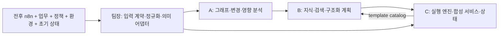

# 팀장이 지금 진행할 일과 첫 구현 인계

작성일: 2026-10-11 · 작업: [platform #8](https://github.com/serendipity-sec/platform/issues/8)

기존 전체 설계와 4인 역할 계획을 이어 **실제로 개발을 시작하는 순서**를 설명한다.
L/A/B/C 작업 ID를 유지한다. 작성일을 팀의 D1·개별 마감일로 간주하지 않는다.

## 1. 전체 흐름과 팀장의 위치



예를 들어 주문 조회의 응답에 `display_status`를 추가한다고 하자.

1. 팀장은 수정 전후 JSON을 같은 주문 업무·정책·초기 상태와 묶는다.
2. A는 노드 ID로 전후를 대응시키고 응답 설정의 변경 위치를 찾는다.
3. B는 관련 지식과 등록된 정상 업무 템플릿을 연결해 계획 파일을 만든다.
4. C는 각각 별도 상태에서 업무를 실행하고 응답·이벤트·상태 파일을 저장한다.

이번 코드가 만든 부분은 **1번의 입력·구조 정규화와 전달 파일**이다.
2~4번은 후속 구현이다. 네 역할은 모두 구현 역할이다.

## 2. 팀장이 오늘 진행할 순서

| 순서 | 할 일 | 지금 상태 | 완료 산출물 |
|---|---|---|---|
| 1 | 공통 입력 형식·오류 처리를 코드로 정한다 | 이번 브랜치에 구현 | 모델·JSON Schema |
| 2 | 정상 사례를 읽고 전후 인계 파일을 만든다 | 이번 브랜치에 구현 | CLI·합성 예제·snapshot |
| 3 | 팀원별 첫 작업을 전달한다 | 아래 카드 준비 | 실명·첫 출력일·소비 파일 합의 |
| 4 | C와 runtime 조합을 맞추고 L-03을 잇는다 | 후속 구현 | support matrix 첫 행·노드 의미 |
| 5 | A/B/C의 실제 파일을 연결한다 | 후속 구현 | 첫 정상 업무의 모듈 간 연결 |

첫 목표는 **같은 입력과 필드명으로 동시에 개발을 시작하는 것**이다.
A와 B는 C의 환경 설치가 끝날 때까지 기다리지 않고 구조 예시와 수작업 계약으로 시작할 수 있다.

## 3. 이번에 코드로 진행한 팀장 작업

### 개발 기준

Python 3.13.15, uv 0.9.30, Pydantic 2.14.0, Typer 0.27.3/Rich 15.0.0을 사용한다.
pytest 9.1.1·Ruff 0.17.0·mypy 2.4.0과 함께 `uv.lock`으로 고정한다.
DB·그래프·모델 패키지는 해당 담당자의 모듈에서 추가한다. 첫 설치에 API 키는 필요 없다.
공식 라이선스 원문과 이용 방식은 [THIRD_PARTY.md](../THIRD_PARTY.md)에 기록했다.

### 입력 파일

```text
examples/order-lookup/
  manifest.json           ID·경로·바이트 수·SHA-256
  case.json               전후·업무·정책·환경·상태·출처 연결
  task.json               목적·정상 입력·완료 조건·허용 부수 효과
  policy.json             규칙·적용 주체·근거
  environment.json        목표 runtime·예정 서비스 연결
  provenance.json         합성 출처·변형·재사용 상태
  state/initial.json      합성 주문 1건·빈 이벤트 목록
  workflow/before.json    수정 전
  workflow/after.json     표시용 응답 필드가 추가된 수정 후
```

이번 비교는 **업무·정책·환경·초기 상태를 고정하고 workflow만 바꾸는 경우**다.
정책·업무 변경 실험은 별도 변경 축을 구현한 뒤 편입한다. 로더는 특정 case ID를 하드코딩하지 않는다.
입력 manifest는 자신을 제외한 8개 JSON을 선언한다. 미참조 파일 탐색·원격 다운로드·archive 해제는 없다.
참조 순환은 고정 역할 구조와 일치 검사로 거부한다. 해시는 내용 대응을 위한 것이며 출처 서명은 아니다.

### 인계 생성 명령

```powershell
uv sync --frozen
uv run --frozen flowdelta inspect-case examples/order-lookup
mkdir var
uv run --frozen flowdelta snapshot examples/order-lookup --out var/order-lookup-001
```

`var`가 있으면 `mkdir`은 생략하고, 출력 폴더는 새 이름으로 지정한다.

| 파일 | 내용 | 우선 소비자 |
|---|---|---|
| `before.normalized.json`, `after.normalized.json` | 노드·typeVersion·parameter·포트 연결·원본 위치·보존 필드 | A |
| `semantics.json` | 전후 노드별 의미 상태. 아직 모두 `UNKNOWN` | A |
| `snapshots.json` | 전후 ID·원본/구조 해시·고정 문맥 참조 | A·C |
| case·업무·정책·환경·상태·출처·workflow | 읽어서 확인한 입력 바이트 그대로 | B·C |
| `source-manifest.json` | 입력 manifest의 구조화 사본 | A·C |
| `manifest.json` | 원본 8개와 생성물 5개의 크기·해시 | 모든 소비 모듈 |

`required_artifacts`의 `response`, `initial-state`, `final-state`는 앞으로 필요한 **자료 종류**다.
현재 존재하는 파일 참조가 아니다. 후속 검색·계획에서 필요한 항목을 임의로 삭제하지 않는다.

출력은 검사를 마친 메모리상의 바이트를 사용한다. 읽은 뒤 바뀐 원본을 다시 복사하지 않는다.
임시 폴더에서 준비한 파일을 새 출력 폴더로 옮기고 **manifest를 마지막에 게시**한다.
소비자는 manifest가 없으면 미완성 출력으로 취급한다. 폴더 전체 rename의 원자성을 주장하지 않는다.
실패 후 남은 출력 폴더는 자동 재사용하지 않고 새 이름으로 만든다.

### 상태·해시의 정확한 의미

| 값 | 뜻 |
|---|---|
| `STRUCTURE_PARSED` | JSON 구조와 연결을 읽었다 |
| `semantic_support=UNKNOWN` | 실제 n8n 동작에 대응하는 의미 어댑터가 아직 없다 |
| `runtime_status=NOT_VALIDATED` | 환경의 목표 버전은 실행 확인 전이다 |
| `execution_status=NOT_RUN` | workflow를 실행하지 않았다 |
| `semantic_sha256=null` | 의미 동등성 해시를 계산하지 않았다 |
| `dependency_status=UNRESOLVED` | 하위 workflow·도구 참조를 실제로 연결하지 않았다 |
| 정책 `DECLARED_ONLY` | 사람이 작성한 정책 문장을 보존했다 |

구조 해시는 공백·객체 키 순서만 정리한다. 좌표·노드 이름·배열 순서·알 수 없는 필드를 보존한다.
전체 설계의 **의미 해시는 L-03/04 이후에 추가**한다. 구조 해시를 의미 캐시에 사용하지 않는다.
정상 응답을 보안상 통과로 변환하지 않는다. 결과 상태를 담당자 역할 이름으로 배정하지 않는다.

### 계약을 수정하는 방식

- 팀장은 `contracts.py`, `ingestion.py`, `normalize.py`, `handoff.py`의 입력 부분을 담당한다.
- A/B/C는 각각 `graph/`, `knowledge/`, `runtime/` 모듈과 자신의 CLI 명령을 추가한다.
- 공통 모델 변경은 소비 파일과 호환 영향을 PR에 적고, 생성 Schema와 예제를 함께 갱신한다.
- JSON Schema의 `$defs`에서 개별 파일에 맞는 `ComparisonCase`, `Manifest`, `NormalizedWorkflow`,
  `SnapshotIndex`, `SemanticsIndex`를 선택한다. 루트 `Handoff`는 내부 전체 묶음이다.
- 모든 구현자가 자신의 변경에 필요한 테스트를 함께 추가한다.

## 4. 오늘 배분할 첫 작업 카드

실명과 날짜를 채우면 전달할 수 있다. 개인 배정이나 팀원에게 메시지 전송은 아직 하지 않았다.

### 팀장 — L-START 후속 / L-03 첫 어댑터

- **입력:** 현재 예제와 C가 확정할 n8n 버전·typeVersion·runtime lock.
- **작업:** Webhook → HTTP Request → Respond to Webhook의 지원 parameter 범위를 정한다.
  표현식은 지원 형태만 해석하고, 나머지는 원본 위치와 이유를 남긴다.
- **첫 산출물:** `support-matrix.json` 첫 조합과 실제 내용을 채운 `NodeSemantics`.
- **끝 조건:** 어떤 필드를 읽고 쓰며 어느 서비스에 요청하는지 A가 사용 가능하다.
  미확인 조합은 `UNKNOWN`/`UNSUPPORTED`로 남긴다.
- **지금 시작할 부분:** C의 환경 준비와 병행해 어댑터 API·정적 모델을 작성한다.

### A — A-START / A-01~03의 첫 구조 연결

- **입력:** 전후 normalized JSON과 `semantics.json`.
- **작업:** 노드 ID·방향·관계 종류·입출력 포트를 유지하는 그래프를 만든다.
  같은 ID의 parameter 변경을 원본 JSON Pointer와 연결한다.
- **첫 산출물:** ID 대응표·변경 위치·처리 범위를 가진 `analysis.json` 예시 1개.
- **끝 조건:** 예제의 응답 parameter 변경을 나타내고, 좌표만 달라진 사례를 별도로 표현한다.
  `UNKNOWN` 의미에서 데이터 흐름·권한 효과를 확정하지 않는다.
- **지금 시작할 부분:** 구조 그래프·대응·diff. 의미 관계는 L-03 이후 추가한다.

### B — B-START / B-01·04의 첫 정상 계획

- **입력:** case/task/policy, A의 수작업 분석 예시, C의 수작업 template catalog.
- **작업:** 출처·적용 조건을 가진 카드 모델·파일 로더와 등록 템플릿 기반의 고정 정상 계획을 만든다.
- **첫 산출물:** 팀 작성 카드 소수와 `plan.json` 예시 1개.
- **끝 조건:** case/snapshot/template ID, 정상 입력·상태·필요 자료 목록이 C의 계약과 연결된다.
  연결되지 않은 필수 항목은 누락 목록에 남긴다.
- **지금 시작할 부분:** DB·벡터 검색·모델 도입 전 파일과 고정 템플릿으로 시작한다.

### C — C-START / C-01·02의 첫 정상 환경

- **입력:** 원본 workflow 두 개, environment/state/task, snapshots/manifest.
- **작업:** 팀 관리 로컬 합성 주문 API·별도 초기 상태·고정 n8n runtime을 준비한다.
  실제 가져오기·게시·호출 방법과 typeVersion 호환성을 lock에 기록한다.
- **첫 산출물:** Compose 설정, `runtime.lock.toml`, `template-catalog.json` 예시.
- **끝 조건:** 정상 요청 한 번의 응답·상태를 저장하고 새 실행용 초기 상태를 만들 수 있다.
- **팀장에게 먼저 줄 것:** n8n/image digest·typeVersion·parameter 조합·요청/응답 형식.
- **지금 시작할 부분:** n8n 준비 전 합성 API와 catalog 계약을 작성할 수 있다.

각 카드는 전체 작업의 첫 조각이다. C-START 완료가 C-03~05 전체의 완료를 뜻하지 않는다.
각 담당자는 저장소 규칙에 따라 자신의 구현 이슈와 PR을 만든다.

## 5. 팀장이 직접 결정해서 전달할 것

| 결정 | 권장 시작안 | 채울 값 |
|---|---|---|
| A/B/C 실명 | 구현 선호와 경험을 확인해 배정 | 미정 |
| D1·첫 출력일 | 가용 시간을 듣고 카드별 첫 파일 제출 시점을 합의 | 미정 |
| 첫 업무 | 합성 주문 조회를 연결용으로 사용 | 팀 합의 필요 |
| runtime 장비 | C의 고정 환경, 나머지는 동일 계약으로 개발 | 장비·자원 미정 |
| 입력 PR의 peer review | 소비자 관점에서 필드·파일을 읽을 팀원 1명 | 미정 |
| 실제 데이터 확보 | 허용된 공개 workflow 또는 동의받은 비식별 업무 | 출처·이용 조건 미정 |

첫 회의에서 **누가 어느 파일을 언제 만들어 누구에게 주는지**를 확정한다.
실명·시간을 임의로 가정하지 않았으므로 이 항목은 팀장이 직접 채워야 한다.

## 6. 실제 환경에 가까운 자료로 이어가는 방법

현재 예제는 개발 연결용이며 연구 데이터셋 전체를 대신하지 않는다.

1. 정상 업무의 원본 workflow·목적·입출력·이용 조건을 묶어서 선정한다.
2. 자격 값·개인정보·실제 발송 대상은 제거하고, 소유 관계·분기·데이터 구조를 보존한다.
3. 외부 서비스는 C의 합성 서비스로 바꾸고, endpoint·필드·제약의 차이를 provenance에 기록한다.
4. 원본 node/typeVersion/operation과 수정 이유를 기록하고 정상 동작의 확인 범위를 runtime과 연결한다.
5. 실제 근거가 있는 정책은 출처를 연결하고, 팀 작성 정책은 합성 정책으로 표시한다.
6. 업무·정책·초기 상태를 고정한 비교부터 수집하고, 같은 원본 파생 사례는 한 family로 묶는다.

공개 template은 실제 업무와 가까운 구조의 후보이다. 운영 사용의 증거로 간주하지 않는다.
운영 사용 여부·재배포 허용·정상 작동 여부를 각각 기록한다. 수집·구축 완료는 아직 주장하지 않는다.

## 7. 현재 확인과 다음 순서

로컬에서 잠긴 설치, CLI 도움말·정상 예제, **테스트 50개**, Ruff·형식 검사, mypy를 확인했다.
테스트는 해시·참조·중복·상한·연결 오류, 원본 보존, 재현성, 오류 시 manifest 미게시를 포함한다.
CI는 Ubuntu/Windows에서 같은 절차와 패키지 빌드를 수행한다. 원격 결과는 PR에서 확인한다.

다음 순서:

1. 팀원 한 명이 입력 PR을 읽고 승인한다. 기여 규칙상 작성자 단독 병합은 하지 않는다.
2. A/B/C 카드의 실명·첫 출력일을 확정하고 각 구현 이슈를 만든다.
3. 팀장은 C와 runtime 조합을 맞추면서 L-03을 구현한다.
4. A의 실제 분석 → B의 정상 계획 → C의 정상 실행을 연결한다.
5. 두 번째 업무를 넣어 공통 코어를 그대로 쓸 수 있는지 확인한다.

GitHub Projects 조회는 현재 토큰에 `read:project` 권한이 없어 진행하지 못했다.
이슈와 PR은 별도로 사용할 수 있다. 팀장이 웹에서 보드에 등록할 수 있다.
이번 작업에서 인증 권한을 변경하지 않았다.

## 8. 근거 문서

- [4인 구현 계획](https://github.com/serendipity-sec/docs/blob/main/plans/team-implementation.md)
- [n8n JSON 내보내기·가져오기](https://docs.n8n.io/workflows/export-import/): JSON 형식과 자격 참조.
- [Pydantic strict mode](https://docs.pydantic.dev/latest/concepts/strict_mode/): 엄격한 입력 타입 계약.
- [기여 규칙](../CONTRIBUTING.md): 이슈 → 브랜치 → PR → 다른 팀원 승인 → squash merge.

기존 전체 아키텍처·평가 계획은 별도 문서로 유지한다.
