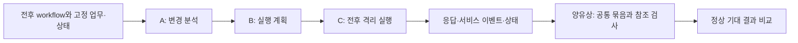

# 교수님께 보여줄 첫 통합 결과

**이번 결과는 네 사람의 첫 구현을 연결하여 주문 조회 변경 전후를 실제 n8n에서
실행하고, 응답·서비스 이벤트·상태·정리 증거까지 한 묶음으로 재현한 것이다.**
정상 사례 한 건을 두 차례 실행했으며 모든 정상 업무 검사가 통과했다.

## 무엇을 만들었나

| 담당 | 이번 구현 | 주문 조회에서 하는 일 |
|---|---|---|
| 김민우 A | 구조 분석·변경 추출 | 표시용 상태 필드가 추가된 변경 1건을 찾는다 |
| 박용준 B | 카드 검색·정상 계획 생성 | 등록된 주문 조회 템플릿과 입력·필수 증거를 계획으로 만든다 |
| 장준서 C | 계획 실행·증거 수집 | 전후를 새 환경에서 실행하고 결과와 정리 상태를 남긴다 |
| 양유상 | 입력 코어·공통 작성기·통합 | 앞 단계 파일을 보존하며 다음 단계에 연결하고 전체를 재현한다 |

## 한 사례로 이해하기

사용자가 `ORD-1001`의 주문 상태를 조회한다. 기존 workflow는 주문 번호와 `준비중`을
돌려준다. 새 workflow는 여기에 사람이 읽기 쉬운 `주문 상태: 준비중`을 덧붙인다.
업무·입력·초기 데이터는 같고 workflow만 달라진다.

A가 이 변경을 분석하고, B가 실제 실행 계획을 만든 뒤, C가 그 계획으로 전후를 실행했다.
분석·계획 예시 파일의 출처 표시만 바꾼 것이 아니라 각 모듈 함수를 실제 호출했다.
등록 catalog와 정상 기대 응답은 팀이 미리 만든 기준 자료로 구분한다.

| 검사 | 실제 결과 |
|---|---|
| 변경 전 응답 | HTTP 200, `order_id=ORD-1001`, `status=준비중` |
| 변경 후 응답 | HTTP 200, 기존 값 유지 + `display_status=주문 상태: 준비중` |
| 서비스 이벤트 | 각 실행에서 해당 주문의 ORDER_READ 1건 |
| 상태 | 초기 이벤트는 비어 있고 주문 데이터는 실행 전후 동일 |
| 격리 | 두 번의 비교·총 네 실행에 서로 다른 실행 ID와 환경 |
| 수집·정리 | 네 실행 모두 COMPLETE, 해당 프로젝트 잔여 리소스 없음 |
| 파일 연결 | 실행별 42개 artifact, 해시·크기·참조 검사 통과 |
| 자동 코드 검사 | 통합 195개 테스트, Ruff, mypy, 두 계약 예제, 패키지 빌드 통과 |

## 직접 보여줄 순서

1. [첫 실행 요약](../examples/module-outputs/integrated-order-lookup/run-1/summary.json)을 연다.
   `all_normal_checks_passed: true`와 전후 응답을 보여준다.
2. [A 분석](../examples/module-outputs/integrated-order-lookup/run-1/bundle/analysis.json)의
   `changes`에서 변경 1건을 확인한다.
3. [B 계획](../examples/module-outputs/integrated-order-lookup/run-1/bundle/plan.json)의
   `normal_input`, `template_id`, `obligation_bindings`를 보여준다.
4. [C 변경 후 실행 기록](../examples/module-outputs/integrated-order-lookup/run-1/bundle/runs/after-1.run.json)의
   실행·수집·정리 상태를 보여준다.
5. [두 번째 실행 요약](../examples/module-outputs/integrated-order-lookup/run-2/summary.json)과
   [재현 비교](../examples/module-outputs/integrated-order-lookup/repeatability.json)에서
   분석·계획은 같고 실행 ID는 다른 것을 보여준다.
6. 시간이 있으면 [재현 명령](MODULE_BUNDLE.md)으로 새 출력 경로에 다시 실행한다.

## 1분 설명

“이번 주에는 팀원의 첫 분석기·계획 생성기·실행기를 제 입력 처리와 공통 파일 작성기에
연결했습니다. 주문 조회 workflow에 표시용 상태 필드를 추가한 사례를 사용했습니다.
분석기가 변경 한 건을 찾고, 생성된 계획으로 실제 n8n 전후 환경을 각각 실행했습니다.
예상 응답뿐 아니라 별도 주문 서비스의 조회 이벤트, 주문 데이터 불변, 실행 후 정리도
확인했습니다. 같은 과정을 두 번 실행해 재현성과 실행 간 분리를 확인했고, JSON 증거와
재현 명령을 남겼습니다. 현재는 정상 사례를 끝까지 연결한 단계이며, 다음은 공격 시나리오와
독립적인 보안 판정·평가 데이터셋을 붙이는 것입니다.”

## 질문이 나오면

- **지금 취약점을 탐지했나?** 정상 사례의 전체 연결과 관측을 확인했다. 보안 판정은 null이다.
- **실제 실행인가?** n8n 2.42.6과 주문 서비스를 Docker에서 실행했다. 가짜 실행기 단위 테스트와
  실제 실행 증거를 분리했고 각 run에 엔진·이미지·서비스 소스 해시가 있다.
- **왜 입력과 상태를 고정하나?** 다른 조건 때문에 생긴 차이를 workflow 변경의 영향으로
  잘못 해석하지 않기 위해서다.
- **팀장이 추가한 부분은?** 파일을 수동 수정하지 않고 연결하는 작성기, 경계 검증,
  전체 재현 명령과 정상 결과 확인을 추가했다. 리뷰 중 A/B/C 오류도 회귀 테스트와 함께 보완했다.
- **남은 일은?** A 영향 경로와 더 넓은 의미 분석, B 위협 시나리오 확장, C 추가 템플릿,
  독립 보안 oracle와 대표성 있는 평가 데이터다. 이번 한 건으로 탐지 성능을 주장하지 않는다.
